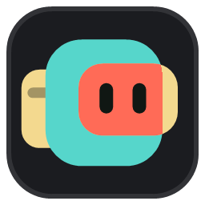
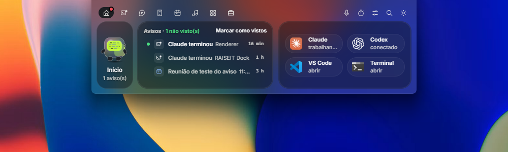
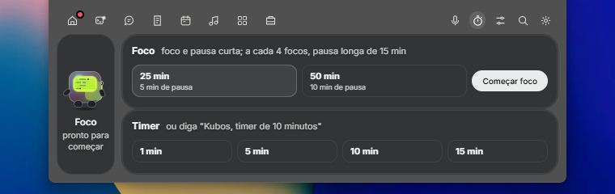
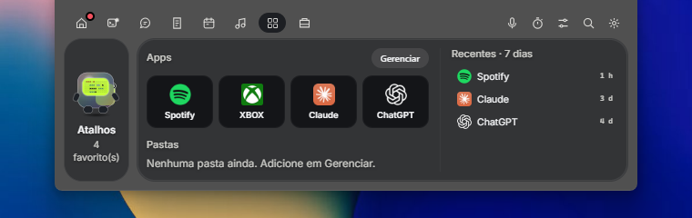
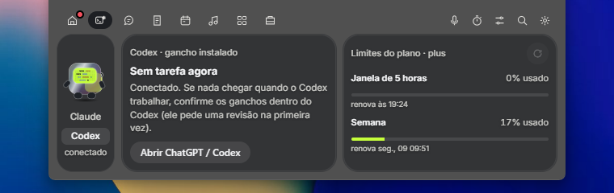
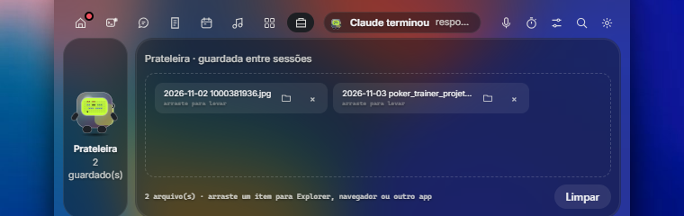
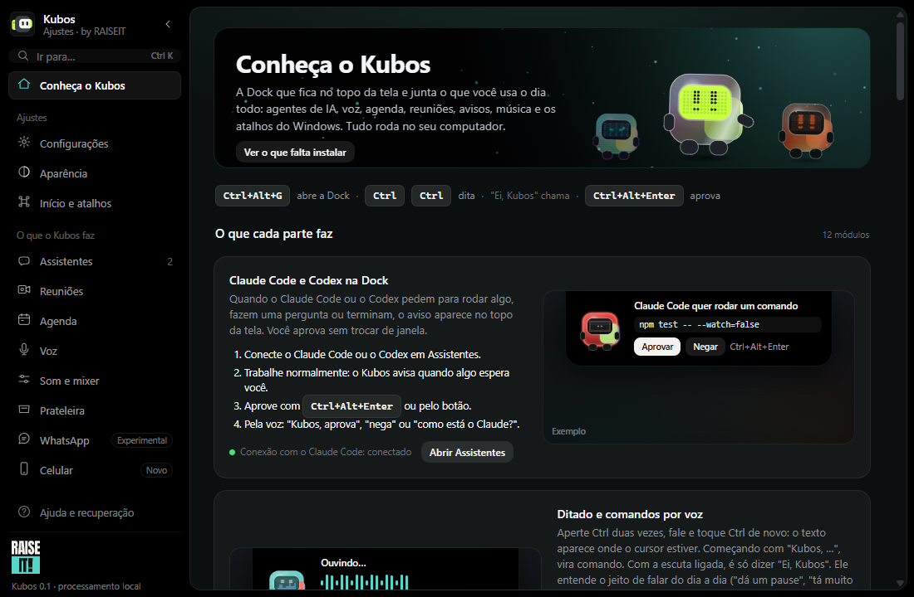
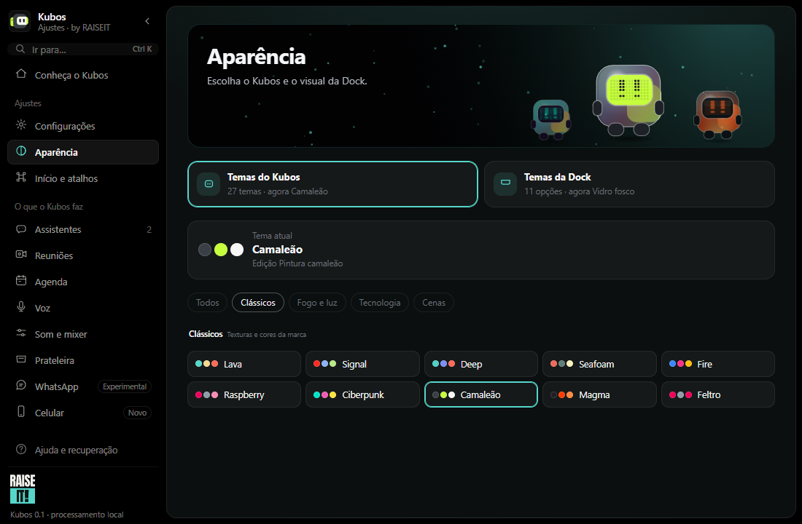

  

<h1 align="center">Kubos</h1>

  Uma ilha no topo da tela do Windows que junta o que você usa o dia todo: 
  agentes de IA, voz, reuniões, agenda, música, foco e notas. Tudo rodando no seu computador.

  <a href="https://github.com/vic-hgo/kubos-releases/releases/latest"><b>⬇ Baixar a versão mais recente</b></a>
  &nbsp;·&nbsp;
  <a href="https://www.instagram.com/raiseit.br/">Instagram @raiseit.br</a>
  &nbsp;·&nbsp;
  <a href="#english">English</a>

  

---

## O que é

O Kubos é uma **Dock flutuante** para Windows 10 e 11. Ela fica recolhida no topo da tela, como um notch, e se abre quando você precisa. Quem mora nela é o **Kubos**, um mascote que reage ao que está acontecendo: pensa quando um agente trabalha, avisa quando algo pede a sua atenção e muda de cara com o tema que você escolher.

  
   Recolhida, ela vira um notch que mostra o que está acontecendo.

## O que ele faz

| | |
|---|---|
| **Claude Code e Codex** | Os pedidos de permissão aparecem na Dock: aprove com um clique ou com Ctrl+Alt+Enter, veja as edições ao vivo e responda quando o agente terminar. |
| **Voz** | Aperte Ctrl duas vezes e dite em qualquer campo. Ou diga "Ei, Kubos" e peça: volume, timer, pesquisa, mensagem no WhatsApp, print. Entende português e inglês, e a transcrição é feita no próprio PC. |
| **Reuniões** | Grava a sua voz e o som da chamada, transcreve ao vivo e separa quem falou. Fica tudo guardado no seu computador, com busca. |
| **Agenda** | Google Agenda ou Outlook, com aviso 10 minutos antes: Entrar, Entrar e gravar ou mais 5 minutos. |
| **Prateleira** | Um lugar para deixar arquivos à mão: arraste para a Dock, leve depois para qualquer app. E a ponte entre o celular e o PC (veja abaixo). |
| **Dia a dia** | Música e volume por app, timer de foco, notas, Wi-Fi, Bluetooth e atalhos. |
| **Do seu jeito** | 27 temas do Kubos (alguns animados, como Lava, Aquário e Néon), 11 temas da Dock, modo claro e escuro, sons e atalhos que você define. |
| **No celular** | Um app Android com widgets e notificações que conversa com o PC pelo Wi-Fi de casa: Prateleira, notas, resumo do agente, "Abrir no PC" e achar o celular pela voz. |

<table>
  <tr>
    <td> Foco e timer</td>
    <td> Atalhos para os seus apps</td>
  </tr>
  <tr>
    <td colspan="2"> Agentes conectados e o uso do plano</td>
  </tr>
</table>

### Prateleira: do celular para o PC e de volta

A Prateleira é o jeito mais rápido de passar documentos, fotos e textos entre o celular e o computador, sem cabo, e-mail ou mandar mensagem para si mesmo.

- **Do celular para o PC:** mande uma foto ou um arquivo pelo app, ou use o **Compartilhar** de qualquer app do Android. Ele aparece na Prateleira da Dock e fica salvo em `DocumentosKubos do celular`, com a data na frente.
- **Do PC para o celular:** o que está na Prateleira da Dock aparece no app, com miniatura. Toque para baixar (ou baixe tudo de uma vez) e o arquivo vai para `Download/Kubos` no celular.
- **Copiar e colar:** copie um texto no PC e cole no celular, ou o contrário, pelo widget ou pela aba Prateleira.
- **No PC:** arraste arquivos para a Dock e leve depois para o e-mail, o navegador ou qualquer pasta. Os prints que você pede ao Kubos também caem lá.

Cada arquivo mostra de onde veio, o celular ou o computador. Tudo passa pelo Wi-Fi de casa, direto entre os dois aparelhos.

  
   A Prateleira na Dock: é só arrastar um item para o Explorer, o navegador ou outro app.

### O Hub

Tudo se ajusta numa janela só: temas, voz, reuniões, agenda, atalhos e o celular. A primeira página explica cada parte do Kubos com exemplos.

  

  

## Como instalar

1. Baixe o `Kubos_<versão>_x64-setup.exe` da [versão mais recente](https://github.com/vic-hgo/kubos-releases/releases/latest).
2. Abra o instalador. Ele ainda não tem assinatura de código, então o Windows pode dizer "O Windows protegeu o seu computador": clique em **Mais informações** e depois em **Executar assim mesmo**.
3. Pronto. Não precisa de administrador nem de internet para instalar.

Depois disso o Kubos **se atualiza sozinho**: quando sai uma versão nova, ele avisa no Hub e instala com um clique.

**App do celular:** no PC, abra Hub › Celular e leia o QR com o Android. O app se atualiza pelo PC.

Funciona no Windows 10 e 11 (64 bits). Português e inglês.

## Atualizações

As novidades de cada versão estão em [Releases](https://github.com/vic-hgo/kubos-releases/releases). As mais recentes:

- **0.1.28** (08/11/2026): achar o celular pela voz com mais jeitos de pedir, como "procura meu celular" ou "cadê meu celular?".
- **0.1.27** (08/11/2026): a gravação de reunião aguenta microfone lento ou com defeito, acabamento da Dock recolhida, atualização sem piscar e app do celular com widgets novos.
- **0.1.26** (02/11/2026): o Kubos chega ao celular, com instalação pelo QR do Hub.
- **0.1.24** (01/11/2026): notas que dá para organizar, Kubos de Feltro e cinco degradês para a Dock.
- **0.1.22** (01/11/2026): nenhum aviso se perde, com a central de avisos na Início.
- **0.1.19** (31/10/2026): "Ei, Kubos" sempre ouvindo, se você quiser.

Para acompanhar o que vem por aí, siga a RAISEIT no Instagram: **[@raiseit.br](https://www.instagram.com/raiseit.br/)**.

## Quem faz

Eu sou o **Victor**, tenho 31 anos e moro em Belo Horizonte (MG). Trabalho como gerente de planejamento e, fora dele, crio ferramentas para o meu próprio dia a dia com ajuda de IA. Me formei em web design em 2012 e, mesmo sem atuar na área, passei anos mexendo com CSS e temas de sites. O Kubos junta esse gosto por visual com a mania de automatizar tudo o que dá.

O Kubos é um projeto da **RAISEIT**. Achou um problema ou tem uma ideia? Me chame no [Instagram](https://www.instagram.com/raiseit.br/).

## Privacidade

Voz, reuniões e notas ficam no seu computador. O Kubos só usa a internet para baixar os modelos de voz (com a sua permissão), procurar atualizações aqui no GitHub e ler a agenda que você conectar.

---

<h2 id="english">English</h2>

**Kubos** is a floating dock for Windows 10 and 11. It stays tucked away at the top of the screen like a notch and opens when you need it. It lives with **Kubos**, a little mascot that reacts to what is going on: it thinks while an AI agent works, lets you know when something needs your attention and changes its look with the theme you pick. Everything runs on your computer, and the app is available in English and Portuguese.

**[⬇ Download the latest version](https://github.com/vic-hgo/kubos-releases/releases/latest)**

### What it does

| | |
|---|---|
| **Claude Code and Codex** | Permission requests show up on the dock: approve with one click or Ctrl+Alt+Enter, watch edits live and reply when the agent is done. |
| **Voice** | Press Ctrl twice and dictate into any field. Or say "Hey, Kubos" and ask for volume, a timer, a web search, a WhatsApp message or a screenshot. Understands English and Portuguese, and transcription happens on your PC. |
| **Meetings** | Records your voice and the call audio, transcribes live and tells speakers apart. Everything stays on your computer, with search. |
| **Calendar** | Google Calendar or Outlook, with a heads-up 10 minutes before: Join, Join and record, or 5 more minutes. |
| **Shelf** | A place to keep files at hand: drop them on the dock, drag them into any app later. And the bridge between your phone and your PC (see below). |
| **Everyday** | Music and per-app volume, focus timer, notes, Wi-Fi, Bluetooth and shortcuts. |
| **Your way** | 27 Kubos themes (some animated, like Lava, Aquarium and Neon), 11 dock themes, light and dark mode, sounds and your own shortcuts. |
| **On your phone** | An Android app with widgets and notifications that talks to your PC over your home Wi-Fi: Shelf, notes, agent summary, "Open on PC" and find your phone by voice. |

### Shelf: from your phone to your PC and back

The Shelf is the fastest way to move documents, photos and text between your phone and your computer, with no cable, no email and no messaging yourself.

- **Phone to PC:** send a photo or a file from the app, or use **Share** from any Android app. It shows up on the dock's Shelf and is saved to `DocumentsKubos from phone`, with the date in front.
- **PC to phone:** whatever is on the dock's Shelf shows up in the app, with a thumbnail. Tap to download (or download everything at once) and the file goes to `Download/Kubos` on your phone.
- **Copy and paste:** copy text on your PC and paste it on your phone, or the other way around, from the widget or the Shelf tab.
- **On your PC:** drop files on the dock and drag them into an email, the browser or any folder later. Screenshots you ask Kubos for land there too.

Each file shows where it came from, phone or computer. Everything travels over your home Wi-Fi, straight between the two devices.

  

### How to install

1. Download `Kubos_<version>_x64-setup.exe` from the [latest release](https://github.com/vic-hgo/kubos-releases/releases/latest).
2. Run the installer. It is not code-signed yet, so Windows may say "Windows protected your PC": click **More info**, then **Run anyway**.
3. That's it. No administrator rights or internet connection needed to install.

From then on Kubos **updates itself**: when a new version is out, it lets you know in the Hub and installs with one click. For the phone app, open Hub › Phone on your PC and scan the QR code with your Android phone.

Windows 10 and 11 (64-bit). English and Portuguese.

### Who makes it

I'm **Victor**, 31, from Belo Horizonte, Brazil. I work as a planning manager and, outside of work, I build tools for my own day-to-day with the help of AI. I studied web design back in 2012 and, even though I never worked in the field, I spent years tinkering with CSS and website themes. Kubos brings together my love for good visuals and my habit of automating everything I can.

Kubos is a **RAISEIT** project. Found a bug or have an idea? Reach out on Instagram: **[@raiseit.br](https://www.instagram.com/raiseit.br/)**.

### Privacy

Voice, meetings and notes stay on your computer. Kubos only goes online to download the voice models (with your permission), check for updates here on GitHub and read the calendar you connect.
